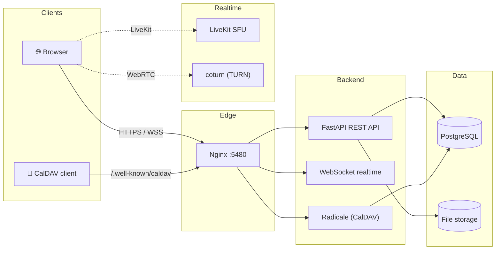

<p align="center">
  
</p>

<h1 align="center">Kumo ☁️</h1>

<p align="center">
  <b>The unified engineering workspace for students.</b><br/>
  Communication, knowledge, files, planning, and study tools in <i>one</i> connected
  environment — not a collection of unrelated products in tabs.
</p>

<p align="center">
  <a href="#-features"></a>
  <a href="#-tech-stack"></a>
  <a href="#-tech-stack"></a>
  <a href="#-tech-stack"></a>
  <a href="#-tech-stack"></a>
  <a href="#-docker"></a>
</p>

<p align="center">
  <a href="#-security"></a>
  <a href="#-calendar--caldav"></a>
  <a href="#-communication"></a>
  <a href="#-collaboration"></a>
  <a href="#-testing"></a>
  <a href="#license"></a>
</p>

---

**Kumo** (Japanese: *雲*, "cloud") is where a student's entire academic life comes
together — chat with classmates, take structured notes, manage files, plan
assignments, and solve problems together on shared whiteboards — all wired to the
same data, so a task links to a note, a note links to a file, and a file lives in a
study room.

---

## ✨ Features

### 🔐 Identity & authentication
- **SchoolApp single sign-on** — a Cloudflare Worker verifies the student identity
  and returns a short-lived, HMAC-signed assertion; the password is never stored.
- **Local email/password** accounts (Argon2id) for the API and tests.
- Rotating, hashed **refresh tokens**, HttpOnly/SameSite cookies, and WebSocket
  login tickets.
- **Profile photos**, bios, study interests, and time zones.

### 📝 Notes & knowledge
- A **block-based editor** with 9 block types — text, headings, lists, checklists,
  quotes, code, dividers, and **LaTeX equations** (KaTeX).
- **Templates** — lecture notes, course pages, meeting notes, lab reports, study
  sessions.
- Nested pages, stable **internal links**, **backlinks**, and Markdown.
- An interactive, **authorization-aware knowledge graph**.

### 🗂️ Vault
- Streamed uploads, inline previews, and a **500 MB quota** with a live meter.
- **7 graded permission levels** (`view → manage`) shared with users, groups, or rooms.
- Public/private links, comments, **ownership transfer**, and quota-friendly unlink.

### ✅ Tasks, projects & calendar
- Tasks with status, priority, due dates, assignees, and **project/group links**.
- Projects with their own task lists — **synced to the global task board**.
- A calendar with **month / week / day / agenda** views, **recurring events**
  (RRULE), task deadlines, and **ICS import/export**.

### 📅 Calendar & CalDAV
- **Bidirectional CalDAV sync** (Radicale) with Apple Calendar, Thunderbird, and
  GNOME Calendar — the app database is the single source of truth.
- **Time zones** with full `VTIMEZONE`/DST handling and **recurrence exceptions**
  (`RDATE`, `EXDATE`, `RECURRENCE-ID`).
- Per-user calendar **name and color** via WebDAV.

### 💬 Communication
- Realtime **direct and group messaging** with reactions, link previews, read
  receipts, and unread counters.
- Peer-to-peer **WebRTC voice calls** and **group audio** over a LiveKit SFU.
- **Groups** with 5 roles and an invite-link → approve/reject flow.

### 🧑‍🔬 Collaboration
- **Study rooms** tying together participants, whiteboards, and documents.
- An infinite **whiteboard** (8 tools, chemistry included) with conflict-free
  concurrent edits and undo/redo.
- **Collaborative PDF annotation** on a non-destructive layer.

### 🗃️ Databases & chemistry
- **Notion-style databases** — 11 property types, table/board/gallery/calendar
  views, and a safe formula evaluator.
- **Chemistry** powered by RDKit — SMILES and a **2D sketcher**, molecular
  verification, and a **3D viewer** (Three.js) with CPK colors.

### 🔎 Search, notifications & personalization
- **Global search**, a `Ctrl/Cmd+K` **command palette**, and quick capture.
- In-app notifications plus **browser push**.
- **8 accent colors**, light/dark themes, and adjustable corner radius and text size.

---

## 🏗️ Architecture



Every feature — messages, notes, files, tasks, events, whiteboards — reads and
writes the **same PostgreSQL database**, so links between them are real, not
decorative.

---

## 🛠️ Tech stack

| Layer | Technology |
|-------|-----------|
| **Frontend** | React 18 · Vite · React Router · TanStack Query · Zustand · Lucide |
| **Rich content** | KaTeX (LaTeX) · react-markdown · PDF.js · d3-force · Three.js |
| **Backend** | FastAPI · SQLAlchemy 2.x · Alembic · psycopg v3 |
| **Database** | PostgreSQL (SQLite for local dev/tests) |
| **Auth** | Argon2id · HMAC-signed tokens · rotating refresh sessions |
| **Realtime** | WebSocket · WebRTC · LiveKit · coturn |
| **Calendar** | RFC 5545 (RRULE) · ICS · CalDAV via Radicale |
| **Chemistry** | RDKit |
| **Deploy** | Docker Compose · nginx · NixOS |

---

## 🚀 Quick start (development)

Prerequisites: Node 20+, Python 3.12+, [`uv`](https://docs.astral.sh/uv/).

```sh
# Backend
cd backend
uv sync
uv run alembic upgrade head
uv run uvicorn app.main:app --reload --port 8000

# Frontend (separate terminal)
cd frontend
npm install
npm run dev          # http://localhost:5173 (proxies /api to :8000)
```

Use SQLite without PostgreSQL by setting `DATABASE_URL=sqlite:///./data/kumo.db`.

Sign in with **SchoolApp** (identity verified by the Cloudflare Worker in
`infra/schoolapp-worker/`). Local email/password auth is available on the backend
API for development.

## 🐳 Docker

```sh
cp .env.example .env    # set SECRET_KEY, origins, COOKIE_SECURE=true
./scripts/setup.sh      # render infra/livekit.yaml + infra/turnserver.conf from .env
docker compose up -d --build
```

One command brings up **PostgreSQL + backend + frontend + LiveKit + coturn +
Radicale** behind a single nginx reverse proxy on **http://localhost:5480**.

### 📅 Connecting a CalDAV client

| Field | Value |
|-------|-------|
| **Server URL** | `https://your-host/caldav/` |
| **Username** | your Kumo email or username |
| **Password** | your Kumo password |

Discovery happens automatically via `/.well-known/caldav`. **SchoolApp users**:
generate a password under **Settings → CalDAV** (the token rotates on every login).

---

## 🔒 Security

- Argon2id password hashing and rotating, hashed refresh tokens.
- **Deny-by-default** authorization; inaccessible resources return `404` (no
  existence leak), re-checked live on every request and WebSocket event.
- Markdown sanitization, a sandboxed formula evaluator, and traversal-safe file
  storage.
- Parameterized queries, a narrow CORS allow-list, and no logging of secrets or
  message/file contents.

See [`docs/SECURITY.md`](docs/SECURITY.md) for the full threat model.

---

## 🧪 Testing

```sh
cd backend && uv run pytest     # 47 tests, incl. a 100-user concurrency stress test
cd frontend && npm run build    # production build
```

---

## 📚 Documentation

- [`docs/INSTALL.md`](docs/INSTALL.md) — full installation & setup guide.
- [`docs/API.md`](docs/API.md) — endpoint reference.
- [`docs/SECURITY.md`](docs/SECURITY.md) — threat model and hardening.
- [`docs/CONCURRENCY.md`](docs/CONCURRENCY.md) — ~100 concurrent users, conflict handling, scale-out.
- [`docs/DEPLOYMENT_NIXOS.md`](docs/DEPLOYMENT_NIXOS.md) — NixOS deployment.
- [`docs/BACKUP_RECOVERY.md`](docs/BACKUP_RECOVERY.md) — backup/restore.
- [`FEATURES.md`](FEATURES.md) — the full, factual feature inventory.

---

## License

Kumo is free software licensed under the [GNU General Public License v3.0](LICENSE).
See [`LICENSE`](LICENSE) for the full text.

---

<p align="center">
  Made for students who want to <b>build</b>, not juggle tabs. ☁️
</p>
